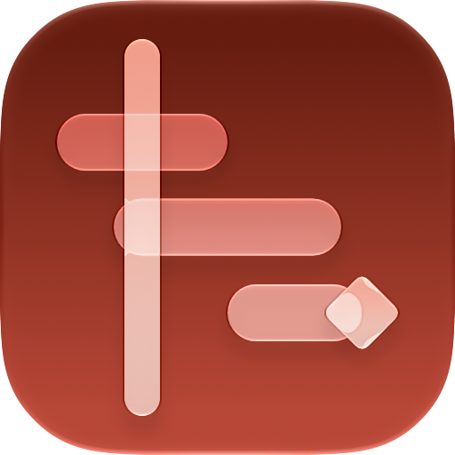
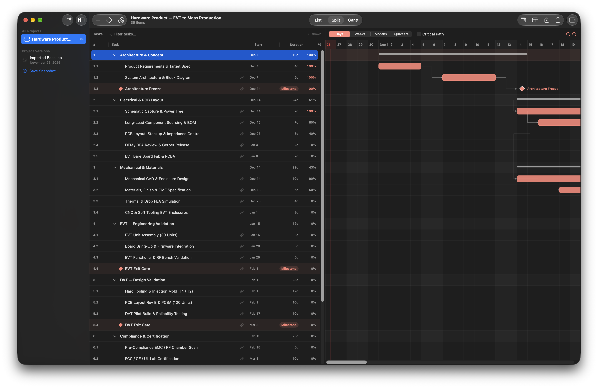

<p align="center">
  
</p>

<h1 align="center">Schedule</h1>

<p align="center">
  A native macOS project scheduling app with plain-English dependencies, Gantt charts, and formula-driven Excel/Numbers export.
</p>

<p align="center">
  <a href="https://github.com/passs0/Schedule/releases/latest"></a>
  
</p>

<p align="center">
  
</p>

---

## What it does

- **Pages-style Welcome & Templates** — Launch straight into a compact Welcome screen to open recent files, import task lists, or click **New Document… (`⌘N`)** to start from **Blank**, **Hardware & Electronics NPI**, **Software & Firmware Release**, **System Cutover & Migration**, or **Compliance & Lab Certification**.
- **Plain-English dependencies** — Express relationships naturally (like `After Architecture Freeze` or `2d after Schematic Capture`) with full Finish-to-Start, Start-to-Start, Finish-to-Finish, Start-to-Finish, and lag support.
- **List, Split, and Gantt views** — Edit hierarchical WBS task lists alongside an interactive timeline with synchronized Split View scrolling, Days/Weeks/Months/Quarters zoom, Critical Path highlighting, and full `⌘Z` / `⇧⌘Z` Undo/Redo.
- **Working calendars & holidays** — Customize working days per task, team, or project and import public or team holidays from Apple Calendar or `.ics` files.
- **Project versions & diff** — Save schedule snapshots and compare timeline, duration, and dependency changes across revisions.
- **Microsoft Project `.mpp` / `.xml` & spreadsheet import** — Directly import binary Microsoft Project `.mpp` files (MPP14+ / Project 2010 and later) and import/export MSPDI `.xml` files (preserving hierarchy, dates, durations, milestones, completion percentages, and dependencies), or import task lists from `.xlsx`, `.csv`, and `.tsv` files with hierarchy preserved.
- **Formula-driven Excel & Numbers export** — Export live-formula `.xlsx` workbooks (including summary rollups and dependency sheets) or convert straight into native `.numbers` documents via Apple Numbers.

## How it compares

| Capability | Schedule | Microsoft Project | OmniPlan | Merlin Project | GanttProject |
| :--- | :--- | :--- | :--- | :--- | :--- |
| **Native macOS SwiftUI app** | **Yes** (macOS 15+) | No (Windows / Web) | Yes (AppKit) | Yes (AppKit) | No (Java) |
| **Plain-English dependencies** | **Yes** (`2d after X`) | No (IDs / codes) | Partial | Partial | No (IDs / dialogs) |
| **Critical Path & `.ics` calendars** | **Yes** | Yes | Yes | Yes | Partial |
| **Version snapshots & diff** | **Yes** | Baselines | Baselines | Snapshots | No |
| **Formula-driven `.xlsx` / `.numbers`** | **Yes** | Static export | No formulas | No formulas | CSV / static |
| **MS Project `.xml` (MSPDI) interop** | **Yes** | Yes | Pro only | Yes | Yes |
| **Direct binary `.mpp` import** | **Yes** (MPP14+) | **Yes** | **Pro only** | **Yes** | Partial |
| **Resource leveling & cost tracking** | No | **Yes** | **Yes** | **Yes** | Basic |
| **Price** | **Free / Open source** | Subscription | Paid | Subscription | Free / Open source |

**Where Schedule falls short:**
- **MPP14+ binary scope** — Direct `.mpp` import supports Project 2010 and later (MPP14+); legacy pre-2010 or encrypted `.mpp` files must be exported from Microsoft Project via *File → Save As → XML Format (`.xml`)* first.
- **No resource leveling or cost/budget tracking** — Schedule focuses on tasks, dependencies, calendars, milestones, and timelines rather than staff allocation or earned-value accounting.
- **Single-user local documents** — Saves `.schedule` files locally with no real-time cloud co-editing.
- **macOS 15+ only** — Native `.numbers` export also requires Apple Numbers to be installed (though `.xlsx` exports work standalone and open cleanly in Numbers).

## Install

Download `Schedule-macOS.dmg` from the [latest release](https://github.com/passs0/Schedule/releases/latest), open it, and drag `Schedule.app` into `Applications`.

To build from source on macOS 15+:

```bash
chmod +x scripts/build_app.sh
./scripts/build_app.sh
```

## Credits

- Pure-Swift MPP14+ binary layout and `Var2Data` / `TBkndCons` parsing in [`MPPBinaryParser.swift`](Sources/ScheduleCore/Interop/MPPBinaryParser.swift) are ported from [`msp-export`](https://github.com/andrewbergsma/msp-export) by Andrew Bergsma (MIT License).

Built with [Google Antigravity](https://antigravity.google) — 100% AI-written code and UI, steered and tested by hand.
